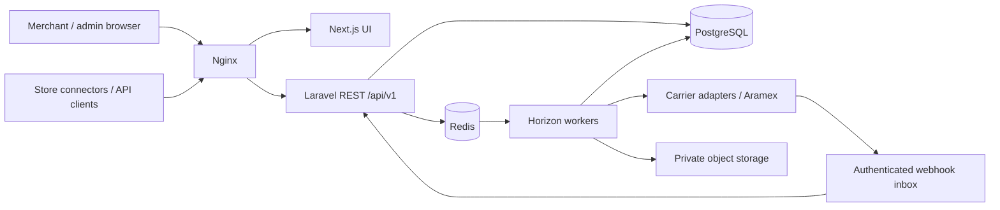

# Architecture — Phase 0 baseline

## Product boundary
ClickToShip serves isolated merchants using one operator-owned Aramex account initially. Domestic and international routes are eligible only after service/account/contract checks. The supplied Technical Blueprint v1.0 (23 October 2026) is the product reference. This baseline implements infrastructure, not merchant shipping or payments.

## Context and deployable units

Next.js must never receive carrier credentials. UI and API share one public origin through Nginx; API/worker share code, database and application encryption key. Scheduled reconciliation runs as a separate process, not inside web requests. PostgreSQL is source of truth; queues/outbox are at-least-once, requiring idempotent consumers. Object storage is planned before imports/labels; Phase 1 uses private local storage and exposes no documents.

## Module ownership
| Module | Owns | Depends on / published effects |
|---|---|---|
| Identity | users, sessions, tokens, roles, permissions | establishes user and active merchant membership |
| Merchants | merchants, memberships, verification, addresses, settings | publishes merchant.suspended; no ledger writes |
| Carriers | accounts, services, route eligibility, credentials, adapters | normalized capabilities/rates/errors; no merchant credentials |
| Pricing | quotes, rules, fees, tax, immutable snapshots | carrier rates; published quotes have expiry |
| Wallet & Billing | wallets, ledger, holds, PSP, refunds, invoices, COD | auditable reserve/capture/release commands |
| Shipping | drafts, packages, customs, submission attempts, documents | consumes pricing, wallets, carriers; shipment events/outbox |
| Pickups | schedules and shipment linkage | explicit create/cancel capability, local timezone rules |
| Tracking | inbox, append-only events, status projection, reconciliation | shipment identifiers and status notifications |
| Bulk | imports, rows, validation, execution progress | invokes same shipping use cases with per-row idempotency |
| Commerce | installations, encrypted tokens, orders, synchronization | scoped store adapters; duplicate order keys |
| Operations | audit, support, reports, settings, notifications | read models and separately authorized admin commands |

Laravel namespaces will use App\Modules\<Module>/{Domain,Application,Infrastructure,Http}; introduce folders when there is code, not placeholder services. Initial shared infrastructure lives under App/Http and App/Support. Dependency direction: HTTP/jobs → application use cases → domain contracts; infrastructure implements contracts. Services return typed internal data, never provider request bodies. No cross-module Eloquent writes from controllers.

## Tenant isolation
Canonical term is merchant; merchant_id replaces blueprint tenant_id consistently. Users are global identities with merchant_users memberships. A user can belong to several merchants, but each request acts as exactly one verified membership. Merchant UUID selection is not authorization. All tenant aggregates carry merchant_id; composite (merchant_id,id) candidate keys support matching composite foreign keys. Unique imported references include merchant and source/store. Token abilities intersect membership permissions. Workers restore context explicitly. Optional PostgreSQL RLS requires separate design/testing and is not claimed in this foundation.

## Shipment submission and financial consistency
```mermaid
sequenceDiagram
  participant API
  participant DB as PostgreSQL
  participant Worker
  participant Carrier
  API->>DB: Atomic idempotency + expired-quote check + wallet lock/hold + pending shipment + outbox
  Worker->>DB: Claim pending attempt, persist submission marker
  Worker->>Carrier: Create once with traceable client reference
  alt Definitive success
    Worker->>DB: AWB + price snapshot + capture hold + outbox, atomically
  else Definitive rejection
    Worker->>DB: Rejection + release hold, atomically
  else Timeout / unknown
    Worker->>DB: submission_unknown; keep hold; reconciliation task
  end
```
Do not hold a database transaction open over HTTP. Crash after transmission also means unknown, including a worker dying before response persistence. Reconcile by documented reference lookup only when confirmed; otherwise operations review. Never assume Transaction.Reference1 or ForeignHAWB is a provider idempotency guarantee. A hold expiry alone cannot resolve an uncertain billable shipment.

## State model
Submission: draft → validating → quoted → payment_reserved → submission_pending → carrier_accepted; rejection → carrier_rejected; uncertain → submission_unknown → reconciled accepted/rejected. Cancel only before submission unless a later carrier cancellation capability is verified. Fulfillment is a separate projection: label_ready, pickup_requested, picked_up, in_transit, out_for_delivery, delivered, delivery_exception, returning, returned, lost. Pickup cancellation does not cancel a shipment. Raw statuses and event history are immutable; event-time plus explicit transition rules prevent stale updates from regressing delivery, while preserving legitimate later return events.

## International and operational policy
Origin, destination, manufacture country, payer and billing currency are distinct. No hard-coded SA origin, CDS availability, universal 14 SAR tariff or automatic FX. Unsupported lanes fail before reservation. Uploads/labels use private storage, bounded parsing, malware scanning and signed authorization. Queue priority separates critical submissions/finance from bulk work. Availability 99.9%, RPO 15 minutes and RTO 4 hours are proposed targets, not measured guarantees. Production needs managed backups/PITR, restoration drill, observability and on-call runbooks.

## Implemented Phase 2 boundaries

`App\Modules\Identity` owns registration, credentials, verification/recovery notifications, sessions, tokens and audit recording. `App\Modules\Merchants` owns organization creation, membership changes, context, tenant policies and job middleware. Controllers validate/authorize and delegate to application services; no business shipping/financial modules were introduced.

Tenant context is a scoped container binding, established from the authenticated session's selection or a bound token. Membership, user and merchant status are rechecked; global tenant-model queries fail closed without context. Tenant model creation/update and PostgreSQL identity constraints prevent reparenting. Global request and queue boundaries clear context before/after execution, including exceptions. Jobs carry merchant+actor+required permission; API-originated jobs must additionally capture the originating token ID using UseMerchantContext's tokenId argument. Execution checks current membership, role, suspension, token binding/version/expiry/revocation and original scope.

Team services lock the merchant root before reauthorization and membership mutation, enforce expected version and retain an active owner. Independent PostgreSQL-process race tests exercise competing changes. Platform assignments do not participate in merchant permission resolution; all platform access paths remain closed. Future explicit support access needs its own time-limited authorization and audit design.

Email notifications are encrypted queued jobs dispatched after commit. Development SMTP uses Mailpit; production must configure private delivery. Verification/reset tokens use URL fragments and POST bodies, never server-facing link query strings. The queue remains at-least-once; notification duplicates are harmless, while financial/shipping outbox semantics remain later work.
