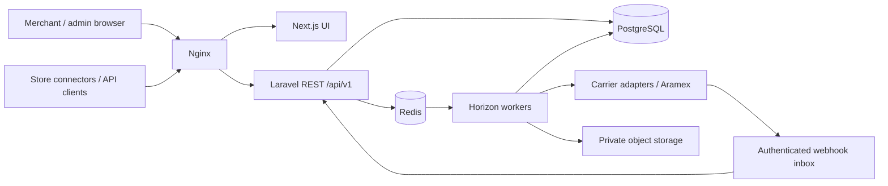

# Architecture — Phase 0 baseline

## Product boundary
ClickToShip serves isolated merchants using one operator-owned Aramex account initially. Domestic and international routes are eligible only after service/account/contract checks. The supplied Technical Blueprint v1.0 (23 October 2026) is the product reference. This baseline implements infrastructure, not merchant shipping or payments.

## Context and deployable units

Next.js must never receive carrier credentials. UI and API share one public origin through Nginx; API/worker share code, database and application encryption key. Scheduled reconciliation runs as a separate process, not inside web requests. PostgreSQL is source of truth; queues/outbox are at-least-once, requiring idempotent consumers. Object storage is planned before imports/labels; Phase 1 uses private local storage and exposes no documents.

## Module ownership
| Module | Owns | Depends on / published effects |
|---|---|---|
| Identity | users, sessions, tokens, roles, permissions | establishes user and active merchant membership |
| Merchants | merchants, memberships, verification, addresses, settings | publishes merchant.suspended; no ledger writes |
| Carriers | accounts, services, route eligibility, credentials, adapters | normalized capabilities/rates/errors; no merchant credentials |
| Pricing | quotes, rules, fees, tax, immutable snapshots | carrier rates; published quotes have expiry |
| Wallet & Billing | wallets, ledger, holds, PSP, refunds, invoices, COD | auditable reserve/capture/release commands |
| Shipping | drafts, packages, customs, submission attempts, documents | consumes pricing, wallets, carriers; shipment events/outbox |
| Pickups | schedules and shipment linkage | explicit create/cancel capability, local timezone rules |
| Tracking | inbox, append-only events, status projection, reconciliation | shipment identifiers and status notifications |
| Bulk | imports, rows, validation, execution progress | invokes same shipping use cases with per-row idempotency |
| Commerce | installations, encrypted tokens, orders, synchronization | scoped store adapters; duplicate order keys |
| Operations | audit, support, reports, settings, notifications | read models and separately authorized admin commands |

Laravel namespaces will use App\Modules\<Module>/{Domain,Application,Infrastructure,Http}; introduce folders when there is code, not placeholder services. Initial shared infrastructure lives under App/Http and App/Support. Dependency direction: HTTP/jobs → application use cases → domain contracts; infrastructure implements contracts. Services return typed internal data, never provider request bodies. No cross-module Eloquent writes from controllers.

## Tenant isolation
Canonical term is merchant; merchant_id replaces blueprint tenant_id consistently. Users are global identities with merchant_users memberships. A user can belong to several merchants, but each request acts as exactly one verified membership. Merchant UUID selection is not authorization. All tenant aggregates carry merchant_id; composite (merchant_id,id) candidate keys support matching composite foreign keys. Unique imported references include merchant and source/store. Token abilities intersect membership permissions. Workers restore context explicitly. Optional PostgreSQL RLS requires separate design/testing and is not claimed in this foundation.

## Shipment submission and financial consistency
```mermaid
sequenceDiagram
  participant API
  participant DB as PostgreSQL
  participant Worker
  participant Carrier
  API->>DB: Atomic idempotency + expired-quote check + wallet lock/hold + pending shipment + outbox
  Worker->>DB: Claim pending attempt, persist submission marker
  Worker->>Carrier: Create once with traceable client reference
  alt Definitive success
    Worker->>DB: AWB + price snapshot + capture hold + outbox, atomically
  else Definitive rejection
    Worker->>DB: Rejection + release hold, atomically
  else Timeout / unknown
    Worker->>DB: submission_unknown; keep hold; reconciliation task
  end
```
Do not hold a database transaction open over HTTP. Crash after transmission also means unknown, including a worker dying before response persistence. Reconcile by documented reference lookup only when confirmed; otherwise operations review. Never assume Transaction.Reference1 or ForeignHAWB is a provider idempotency guarantee. A hold expiry alone cannot resolve an uncertain billable shipment.

## State model
Submission: draft → validating → quoted → payment_reserved → submission_pending → carrier_accepted; rejection → carrier_rejected; uncertain → submission_unknown → reconciled accepted/rejected. Cancel only before submission unless a later carrier cancellation capability is verified. Fulfillment is a separate projection: label_ready, pickup_requested, picked_up, in_transit, out_for_delivery, delivered, delivery_exception, returning, returned, lost. Pickup cancellation does not cancel a shipment. Raw statuses and event history are immutable; event-time plus explicit transition rules prevent stale updates from regressing delivery, while preserving legitimate later return events.

## International and operational policy
Origin, destination, manufacture country, payer and billing currency are distinct. No hard-coded SA origin, CDS availability, universal 14 SAR tariff or automatic FX. Unsupported lanes fail before reservation. Uploads/labels use private storage, bounded parsing, malware scanning and signed authorization. Queue priority separates critical submissions/finance from bulk work. Availability 99.9%, RPO 15 minutes and RTO 4 hours are proposed targets, not measured guarantees. Production needs managed backups/PITR, restoration drill, observability and on-call runbooks.

## Implemented Phase 2 boundaries

`App\Modules\Identity` owns registration, credentials, verification/recovery notifications, sessions, tokens and audit recording. `App\Modules\Merchants` owns organization creation, membership changes, context, tenant policies and job middleware. Controllers validate/authorize and delegate to application services; no business shipping/financial modules were introduced.

Tenant context is a scoped container binding, established from the authenticated session's selection or a bound token. Membership, user and merchant status are rechecked; global tenant-model queries fail closed without context. Tenant model creation/update and PostgreSQL identity constraints prevent reparenting. Global request and queue boundaries clear context before/after execution, including exceptions. Jobs carry merchant+actor+required permission; API-originated jobs must additionally capture the originating token ID using UseMerchantContext's tokenId argument. Execution checks current membership, role, suspension, token binding/version/expiry/revocation and original scope.

Team services lock the merchant root before reauthorization and membership mutation, enforce expected version and retain an active owner. Independent PostgreSQL-process race tests exercise competing changes. Platform assignments do not participate in merchant permission resolution; all platform access paths remain closed. Future explicit support access needs its own time-limited authorization and audit design.

Email notifications are encrypted queued jobs dispatched after commit. Development SMTP uses Mailpit; production must configure private delivery. Verification/reset tokens use URL fragments and POST bodies, never server-facing link query strings. The queue remains at-least-once; notification duplicates are harmless, while financial/shipping outbox semantics remain later work.

## Implemented Phase 3 boundaries

Merchants owns encrypted profiles/address book, typed settings/defaults, immutable business-verification snapshots/decisions and email-bound team invitations. Identity owns MFA and user security/profile changes. Operations owns explicit platform access approval and audited administration; it never injects platform privileges into MerchantContext or bypasses global tenant scopes. SQL queries in management services always derive tenant IDs from context; target-specific admin queries instead pass through Administration::authorizeTarget, checking current platform capability, fresh MFA and an approved session-bound grant for that exact target/capability. Platform directory metadata is separately permissioned and contains no merchant-private contact/profile fields.

The three independent merchant concepts are operational account status, business-verification status and shipping eligibility. New active merchants start business-unverified and can use their dashboards after email verification. Every Phase 3 eligibility response denies shipping because wallet/carrier/contract/restriction checks are not implemented. Verification never changes account activation or authorizes shipping. Profile updates invalidate prior verification, pending submissions freeze profile edits and decisions apply to the exact submitted revision. No documents, regulatory compliance claim, carrier lookup or financial operation.

Every merchant write locks the merchant root, reauthorizes and checks expected version/state. Admin security changes additionally serialize through a PostgreSQL transaction advisory lock; global user suspension locks affected merchants before the user, matching tenant mutation order. Last-owner and last-usable-Super-Admin protections are tested with independent processes. Membership, merchant and user security changes revoke the relevant API credentials; reactivation cannot restore revoked tokens. Existing owners/roles/audits are retained.

TOTP uses OTPHP and its constant-time encoding dependency; no bespoke production OTP algorithm. Enrollment secrets are encrypted/expiring, confirmation is explicit, previously accepted steps cannot replay, and hashed recovery codes are consumed transactionally. Admin permission requires current MFA credential version and a challenge within 15 minutes in the current server-side auth-session registry. Platform users cannot disable MFA while platform assignments remain. Factor replacement invalidates other sessions/tokens and access grants. Offline recovery is password+backup code only; assisted recovery is blocked pending an identity-proof and independent-approval policy.

Invitations hash bearer tokens, encrypt recipient email and queued payloads, use fragments plus POST consumption, and lock/revalidate inviter authority at acceptance. Acceptance cannot overwrite existing membership roles. SMTP notification scheduling occurs after commit. Independent platform access requests expire within 15 minutes, cannot approve themselves, and cannot mint merchant tokens or persist as merchant memberships. Approver role/status/session/MFA version is rechecked at each use. Closure is terminal in this release; reopening requires a future approved workflow.

Generic platform business-profile reads omit contact and registration/tax identifiers even with a view grant. Full submitted business data is available only through an independently approved verification-review capability. MFA writes recheck the locked user/current session and password so concurrent credential revocation cannot complete a stale factor mutation.

## Implemented Phase 4 boundaries

WalletBilling owns currency wallets/accounts, immutable journals/entries, reservation state/event history, refunds, financial approvals, balance/statement projections, idempotency, local durable outbox monitor receipts, reconciliation records and disabled provider boundary. Controllers derive current merchant or require an exact target platform grant; no client-selected merchant/account can bypass policy. Operations' existing grant allowlist is extended additively; Identity retains roles, MFA and sessions. No pricing/carrier/shipment module is introduced.

PostgreSQL finance_command serializes on merchant then wallet/hold/original posting, enforces per-currency balance and spend/refund bounds and commits operation/dedupe/history/projections/outbox together. Immutable journal and entry triggers include deferred balancing and projection checks, plus current-transaction-only entry insertion. Redis is never authoritative for money. Corrections additionally serialize with admin security and sorted user/session locks; maker/checker and their target grants/MFA/session state are revalidated before execution. Production accounting/privilege/operational gates are in docs/finance; no claim of a production runtime-role deployment.

Payments, settlement, withdrawals and shipping charges have no active public command route. Internal financial commands are tested with isolated synthetic fixtures; the application binds only DisabledPaymentProvider. Service-clearing posting templates are provisional pending qualified accountant review. Financial correction execution is hardcoded disabled in normal configuration. Unknown/protected reservations cannot be timed out or manually force-released without a future approved evidence/reconciliation workflow.

## Static pricing estimates

Phase 5 owns versioned pricing configuration and immutable tenant-scoped quotes. It reuses the financial money/currency catalog and has no ledger write path. [Pricing architecture and launch gates](PHASE_5_PRICING.md).

## Implemented Phase 6 carrier foundations

Carriers owns encrypted versioned operator accounts, candidate routes, request-only Aramex adapters, code-owned capability evidence, scoped intent/attempt journals, health and encrypted event retention/queue boundaries. Current V2 response and webhook authenticity contracts are missing, so runtime transport, production and external webhook ingestion remain hard disabled. Legacy SOAP structure tests do not verify JSON integration. No merchant shipment command, wallet write or eligibility activation is introduced. [Carrier architecture and capability-specific stops](PHASE_6_CARRIERS.md).

## Phase 7 shipment orchestration

See [shipment architecture](PHASE_7_SHIPPING.md). Verified carrier observations commit before local financial settlement; accepted/capture-pending cannot be resubmitted. Protected/unknown evidence resolution is additive, independently approved where required, and isolated-test-only. Existing external carrier and real-money gates remain unchanged.

## Implemented Phase 8 bulk preparation

Bulk owns private encrypted imports, streamed validation/mapping/duplicate review, public pricing previews and durable work. It delegates actual draft writes to Shipping and estimates to Pricing; no wallet/carrier/pickup/label execution path. Existing actor/session/token scope is rechecked at each chunk/row, and PostgreSQL work/cursor/reference state survives Redis loss. See [Phase 8 architecture and operational gates](PHASE_8_BULK.md).

## Implemented Phase 9 tracking foundations

Tracking reuses the carrier event store/projection, binds exact merchant/submission/account identity and owns encrypted durable ingress/poll work, conservative projection decisions, redacted monitoring, reconciliation annotations and a disabled notification outbox. No Shipping/financial state mutation. [Evidence boundaries, scheduling, replay policy and launch gates](PHASE_9_TRACKING.md).

## Phase 10 international/customs preparation

Customs owns immutable tenant-bound declaration/profile/country-rule/readiness/review history and durable encrypted draft document work; Shipping still owns the canonical shipment revision and lifecycle. The application boundary writes customs changes through Shipping, invalidating prior revision applicability. Bulk delegates typed customs rows through the same boundary with per-row current permissions. Pricing supplies its existing public preview, not duties or fabricated fees. The Carrier DTO maps only verified base request fields and reports unmapped customs content explicitly. Tracking and the financial ledger are unchanged.

[Customs architecture](PHASE_10_CUSTOMS.md) documents exact arithmetic, composite FKs, maker/checker review, encrypted document leases/commit fences, scanner quarantine and production/external gates. The stronger target-specific `platform.customs.review` grant is required to read private structured declarations; global rule permissions never grant merchant data access.

## Phase 11 merchant operational read composition

MerchantDashboard composes existing Shipping, Tracking, Bulk, WalletBilling, Pricing and Customs data under current merchant/token/session authority. It owns no business state or tables. Only six read indexes are added; UTC period semantics, no-store responses, per-source permission omission, verified-only tracking/acceptance and independently labeled current balances avoid stale permissions or misleading combined KPIs. Existing mutation/financial/carrier boundaries are unchanged. [Detailed source definitions, concurrency and UI design](PHASE_11_DASHBOARD.md).
