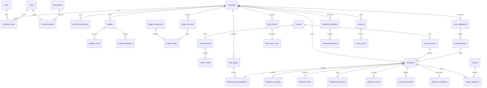
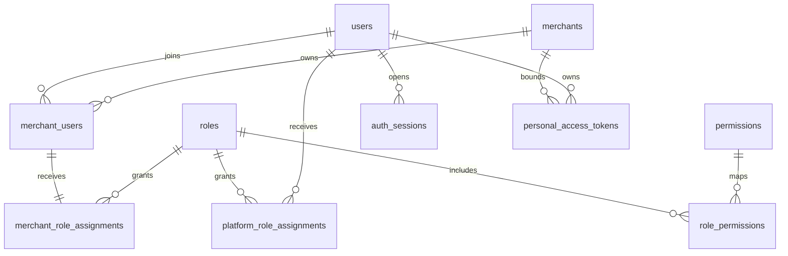

# Database design and initial ERD

This is the **target logical schema**, not a claim that all tables have migrations. Phase 1 migrated identity/framework support; Phase 2 adds the installed tenancy/authentication schema described below. All shipping/financial tables in the conceptual ERD remain unimplemented. No production migration or deployment has occurred.

## Types and invariants
UUID primary keys; merchant_id on every tenant-owned aggregate and child. UTC timestamptz event times; occurred_at and received_at separate. Money = bigint minor amount + char(3) currency; currency exponent from a supported currency catalogue. No float or implicit FX. Weight/dimensions numeric(14,3) + unit. Country char(2); hash/digest references for sensitive payloads; encrypted PII/token columns only where needed. Mutable operational entities have created_at/updated_at; posted finance/event/audit history is append-only. Schema checks reject invalid status/negative values; SQL constraints and services both enforce invariants.

Global user identity can have many merchant memberships. Composite UNIQUE(merchant_id,id) on tenant aggregates plus FK(merchant_id,parent_id) prevents cross-tenant attachments. UUID alone is not isolation. Global carrier accounts are operator-owned and referenced only through authorized services. A user ID in an audit log is not a tenant membership guarantee.

## Initial ERD (conceptual, grouped core relationships)

A quote may have zero/many shipment snapshots. Snapshot is 0:1 per shipment until final price authorization, then immutable. Detailed financial posting model follows below.

## Table catalogue
| Module / tables | Key columns and constraints |
|---|---|
| users | id UUID; normalized email UNIQUE; password hash; verified_at, suspended_at; MFA enrollment later; no tenant FK |
| merchants | id, legal_name, status, base_currency, verification_state; suspension reason/audit; soft deletion only after retention review |
| merchant_users | merchant_id,user_id composite UNIQUE; membership status; role_id scoped to merchant/platform distinction |
| roles, permissions, role_permissions, platform_user_roles | roles scoped merchant/platform; permission code UNIQUE; grants composite UNIQUE(role_id,permission_id); prevent merchant grant of platform privileges; platform_user_roles is separate from merchant memberships, with platform-only roles |
| merchant_settings | merchant_id + key UNIQUE; typed allowlisted values; secrets stored separately |
| merchant_addresses | merchant_id,id candidate key; address/contact, country, postal, type; soft-delete; shipment address snapshot independent of edits |
| carriers, carrier_accounts | carrier code UNIQUE; account carrier/environment/region, encrypted secret reference, status; operator-only access; no credentials in merchant resources |
| carrier_services, carrier_routes | carrier/service code UNIQUE per profile; route origin/destination/product/payment/customs eligibility and effective window; deny unknown combinations |
| carrier_capabilities, carrier_status_mappings | documented/verified/enabled per account/service; raw status mapping version; no implied enabled capabilities |
| shipments | merchant_id,id candidate key; client_reference scoped UNIQUE when supplied; account/service FK; origin/destination; immutable party snapshots; submission_state, fulfillment_state, quote_id; indexed merchant,state,created_at,id |
| shipment_packages | merchant_id,shipment_id matching FK; sequence UNIQUE per shipment; decimal weight/dimensions, units; positive checks |
| shipment_items, shipment_customs | merchant/parent composite FKs; description, HS code, manufacture country, quantity, declared value/currency; duty/tax payer and invoice references; customs 0:1 per shipment |
| shipment_documents | merchant/shipment FK; private object key, MIME/size/hash/type; authorization before signed URL; no permanent public label URLs |
| shipment_attempts | merchant/shipment FK; operation key UNIQUE; state, correlation ID, sent_at, response_at, uncertain_at, redacted outcome reference; attempt metadata durably written before HTTP |
| shipment_events | merchant/shipment FK; source/account/event fingerprint UNIQUE; raw code, normalized code, occurred_at, received_at, location, safe description, payload reference; append-only |
| shipment_exceptions | merchant/shipment FK; type, opened/resolved_at, assigned operator, resolution audit; never delete history |
| pickups, pickup_shipments | merchant/pickup and shipment composite FKs; account, carrier GUID/ref, timezone, ready/end/closing times, status; link UNIQUE(pickup_id,shipment_id); pickup cancellation separate |
| rate_quotes | merchant, service/account, origin/destination, costs/sell/tax/fees minor amounts and currencies, expires_at, rule version; opaque immutable quote result |
| pricing_rules | merchant nullable for platform default, carrier/service/route/weight bands, effective dates, markup/min margin/tax; explicit precedence and no ambiguous overlap |
| shipment_price_snapshots, snapshot_lines | shipment UNIQUE; quoted cost, sell subtotal, fee/tax/discount/margin components, currency, rule version, approved_at; immutable; no dynamic joins to changing rules |
| bulk_imports, bulk_import_rows | merchant/import composite FK; private file, digest, status/counts; row number UNIQUE per import; canonical payload ref, validation errors, execution key, shipment FK, outcome; row idempotency permanent |
| wallets | UNIQUE(merchant_id,currency); liability_account_id; cached posted balance optional, version; available excludes active holds |
| ledger_accounts | currency, class (clearing/liability/revenue/expense/payable/tax/COD); optional merchant; UNIQUE(merchant_id,purpose,currency) for merchant accounts; platform account uniqueness uses NULLS NOT DISTINCT or a separate partial unique index |
| ledger_transactions | id, merchant context if applicable, operation key UNIQUE, currency, posted_at, source/ref, reversal_of_id; immutable after posting |
| ledger_entries | transaction/account FKs, positive amount_minor, debit/credit side; currency matching both parents; no UPDATE/DELETE posted entries |
| balance_holds | merchant/wallet FK; operation UNIQUE, amount_minor >0, currency, state, expires_at, shipment/ref; row locked; captures/releases can only happen once |
| wallet_transactions | read projection of posted ledger_transaction, wallet FK; operation type and balance-after for reporting; never authoritative independent money |
| payment_transactions, payment_events, refunds | merchant/wallet, provider intent and event identifiers UNIQUE by provider, amount/currency, verified state, reconciliation state; refunds reference original posting; idempotent reversal |
| invoices, invoice_items | merchant FK; invoice number scoped fiscal entity UNIQUE; immutable issued tax snapshot; lines reference shipment/snapshot; credit notes instead of edits |
| cod_receivables, settlements, settlement_items | merchant/shipment, collection currency and amount, carrier settlement refs, beneficiary; liabilities distinct from wallet recharge; full reconciliation trail |
| store_integrations, integration_credentials | merchant, provider, external store UNIQUE; encrypted token/ref, scopes/expiry/status; token rotation/revocation; no plaintext token exports |
| external_orders, external_order_items | merchant/store/external_order_id UNIQUE; normalized order and source version; lines relational; no duplicate import or update loop |
| webhook_inbox | source/account/event_fingerprint UNIQUE, auth result, payload object/ref, received/processed timestamps and errors; no shared merchant key routing |
| webhook_endpoints, webhook_deliveries | merchant/endpoints composite FK; verified HTTPS URL, encrypted signing secret ref; delivery(event_id,endpoint_id) UNIQUE; attempt metadata and replay policy |
| notifications, notification_deliveries | merchant/user/channel/template/event, delivery state and attempts; sensitive payload minimization |
| audit_logs | merchant nullable for platform event; actor/type/action, target, reason, request_id, safe change metadata, timestamp; append-only |
| integration_logs | merchant nullable for carrier master, provider/operation/correlation, response code/latency/safe error, payload ref with retention; no raw credentials/PII |
| idempotency_keys | UNIQUE(merchant_id,operation,key_hash), request_hash,status,response ref, lease and expiry; permanent financial dedupe separate from expiring response cache |
| outbox_events | aggregate/event UUID, merchant context, payload version/ref, created/claimed/published_at, retry count; publish after commit, consumers dedupe |
| system_settings | typed platform config + version/audit; secret refs separate |

## Posting and transaction rules
Topup: debit PSP clearing, credit merchant wallet liability only after verified provider event. Shipment: debit merchant liability, credit shipping revenue/tax liability; carrier expense/payable posted separately. Hold reserves available spend without recognizing revenue. Refunds reverse prior postings with unique reversal references. Every ledger transaction must have at least two entries with equal debit/credit total **per currency**. Implement deferred PostgreSQL constraint triggers or posting-procedure enforcement with restrictive runtime grants, plus immutable-entry triggers; a CHECK on a single row cannot prove transaction balance. Do not rely on model callbacks alone. Ledger balances/holds use row locks (consistent lock order), bounded retry on serialization failures and atomic outbox/idempotency persistence. Bookkeeping policy needs accountant signoff before Phase 4 acceptance.

## Index, deletion and migration policy
Index tenant/state/time/id lists; external identifiers and idempotency keys; webhook pending state/received_at; outbox publish readiness; holds(wallet_id,state); entries(account_id,transaction_id); tracking(shipment_id,occurred_at,id). Avoid unrestricted JSON: relational money, parties, packages, items and financial references; JSON only versioned raw provider envelopes/rule predicates/errors where justified. Large provider payloads use encrypted private object references and retention.

No cascaded deletion of shipments, posted finance, events or audits. Restrict parent deletion for historical records; anonymize PII under approved retention without erasing finance. Soft-delete address book/settings entities; issued shipment party snapshots remain stable. Migrations must be reversible until deployment policy permits additive forward-only changes; rehearse upgrades/backfills and constraints on real PostgreSQL. Future RLS policies need non-superuser runtime role, FORCE ROW LEVEL SECURITY and transaction-local tenant settings tested across pooled connections; not enabled in foundation.

## Installed Phase 2 schema

`2026_10_23_010000_create_identity_and_merchant_tenancy` adds merchants, merchant_users, roles, permissions, role_permissions, merchant_role_assignments, platform_role_assignments, auth_sessions and audit_logs; users gain locale, suspension and auth_version; Sanctum tokens gain merchant_id and auth_version. Existing reset/verification support is reused. Built-in catalogues contain ten roles, no user accounts. IDs follow existing UUID conventions.

Membership uniqueness is (merchant_id,user_id); (merchant_id,id) is referenced by role assignments. Composite (role_id,scope) and (permission_id,scope) foreign keys enforce merchant/platform scope. Initial membership has one built-in role. Status/locale/scope/version checks and lower(email) uniqueness are PostgreSQL constraints. Session registry stores a SHA256 session-ID digest and revocation/idle/absolute-expiry metadata; session contents remain Redis. Sanctum stores token hashes only.

`2026_10_23_020000_harden_membership_identity` forbids changes to membership id, merchant_id or user_id in PostgreSQL, and blocks audit TRUNCATE in addition to UPDATE/DELETE. Audit writes contain identifiers and safe metadata only. Database owners can still drop/alter triggers; restricted production runtime roles and off-host retention remain launch work. Functions use CREATE OR REPLACE so disposable migrate:fresh is repeatable. Migration rollback/reapply is exercised only in the dedicated test database; never reset development data as a routine check.

## Installed Phase 3 schema

Three additive migrations follow Phase 2:

* `030000_create_merchant_management`: merchant version and independent verification status; extends account status with closed. Encrypted merchant_profiles/merchant_addresses; typed merchant_settings with composite merchant/address default FKs; immutable verification submissions and separate immutable decisions; encrypted-email invitations with keyed normalized-email digest, hashed token, 72-hour expiry, merchant-role scope FK and optimistic version; new grants on existing built-in roles only.
* `040000_create_privileged_access_security`: encrypted confirmed/pending MFA secrets, expiring enrollment, TOTP last-step/version and hashed single-use recovery codes; auth_sessions gain MFA time/version and composite (user_id,id) identity; users gain admin_version. platform_access_grants bind actor+session and independent approver+approval session, target merchant, constrained capabilities, reason, expiry/revocation/version. PostgreSQL rejects self-approval, wrong session/user pairs, unsupported/wildcard capabilities and lifetimes over15 minutes.
* `050000_harden_merchant_management`: immutable tenant IDs for profiles, addresses, settings and invitations, enforced by PostgreSQL trigger.

Existing audit_logs and role-assignment tables remain authoritative. Submitted business snapshots and review reasons are encrypted; submissions/decisions reject UPDATE, DELETE and TRUNCATE. Contact/physical address/profile payloads use authenticated application encryption, not arbitrary unvalidated JSON: application fields are strictly validated and allowlisted. Database uniqueness is (merchant_id,id); all child/default relationships enforce the merchant component. Country-specific validation is deliberately limited and does not claim carrier validation. No wallet, currency/price, shipment or carrier tables.

Migration rollback/reapply is verified against a populated Phase 2 fixture on clicktoship_test. Rolling back to the pre-Phase-3 account-status constraint intentionally refuses existing closed merchants rather than silently rewriting their status; production schema rollback would require a reviewed data migration. Normal development and isolated browser databases remain separate from the guarded PHPUnit database.
