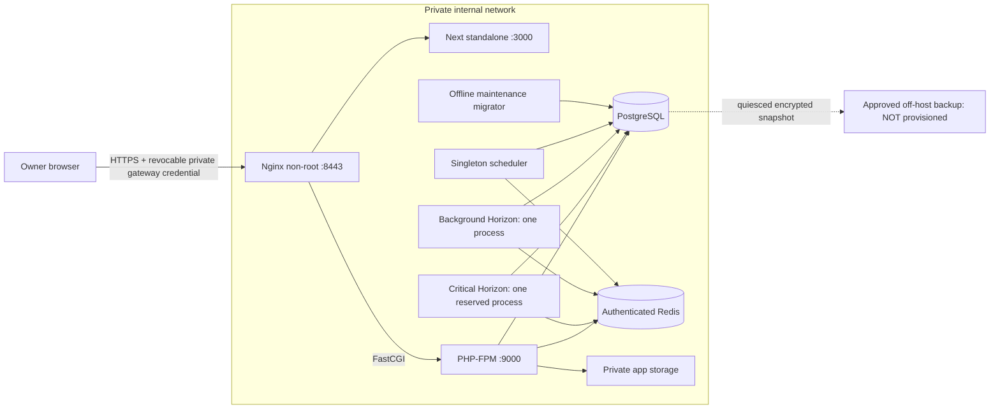

# Protected staging architecture

Phase 17 delivers repository artifacts and a **local simulation**, not hosting authority. No remote host, provider account, DNS or certificate issuance is authorized. Images use verified PHP8.3-FPM, Node24 standalone Next16, PostgreSQL17, Redis7 and Nginx1.28 references. Lockfiles remain authoritative; inspect actual image/runtime versions in the report before promotion.

Standalone `infrastructure/deployment/compose.yml` must never overlay development Compose. Application/DB/Redis traffic is on an internal network. Only the gateway also joins an ingress bridge so Docker can publish its loopback HTTPS port; no backend joins ingress. No public mail, DB, Redis, FPM, Next, Horizon, debugging or storage endpoint. Staging Basic credentials are consumed at the gateway and stripped before upstreams; browser sessions/CSRF remain required by Laravel. Bearer API testing is deliberately unavailable through this Basic-only gateway; do not forward its password as an application credential.

Runtime images have no source bind mounts/vendor test dependencies, use uid10001, read-only roots, dropped capabilities, no-new-privileges, bounded temporary files, memory/CPU/PID budgets and rotated Docker output. PG initialization retains official-image privilege changes and a writable owned volume; it is not claimed rootless. Redis runs uid999 with auth/noeviction and a private volume. SQL runtime has no owner/DDL/superuser/create-role/bypass rights; zero-wallet provisioning is column-limited, amounts are writable only through the existing finance function; column-only frozen updates support existing reconciliation/row locks. Tenant authorization remains the application/constraints boundary; no new RLS claim.

One exact gateway IP is trusted for forwarded client IP/protocol, never forwarded host. Its subnet must be reviewed for host network collisions. Fixed environment/project names are not permission to reuse retained volumes or secrets. Separate migration credentials exist only in an explicit maintenance profile, not normal API/workers. Production has no enabled Horizon plan in this phase and cannot be inferred deployable from staging configuration.

Internal network isolation blocks external SMTP/providers. Local simulation does not deliver email. A real staging registration/invitation journey needs a separately approved private mail sink and controlled egress; opening general internet egress is not approved. Real integrations and all private artifact gates remain closed. CSP with Next-compatible nonces, resource tuning, retention and host firewall/TLS termination need actual-host review.
